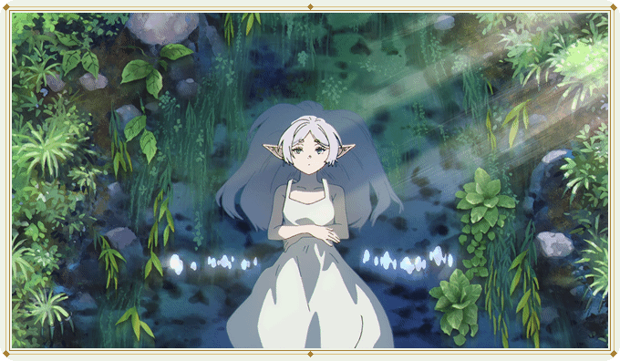

<a href="https://x.com/1naichii">X</a> · <a href="https://github.com/1naichii">GitHub</a> · <a href="https://github.com/1naichii/ai-engineering-starter">ai-engineering-starter</a>

An unofficial fan-made profile, not affiliated with the rights holders. All pictures are official art from the <a href="https://frieren-anime.jp/">anime site</a>: 
art boards 回想 / 廃教会 / 花畑 and グランツ海峡 / 村 / 波止場 painted by スタジオワイエス (Studio Wyeth), character visuals and chibi characters from the <a href="https://frieren-anime.jp/special/gallery/">gallery</a>,
episode stills (and the magic circle) from the <a href="https://frieren-anime.jp/story/">story</a> pages, spell stills from the <a href="https://frieren-anime.jp/special/magic/">magic</a> page, and the <a href="https://frieren-anime.jp/special/map/">journey map</a>.
Music cues are track titles from Evan Call's soundtracks.
GIF: a scene from the TV anime (Madhouse). 
<i>Frieren: Beyond Journey's End</i> © 山田鐘人・アベツカサ／小学館／「葬送のフリーレン」製作委員会 (©K.Y.T.A/S/FP).
Type set in Cinzel and EB Garamond (SIL Open Font License 1.1).

